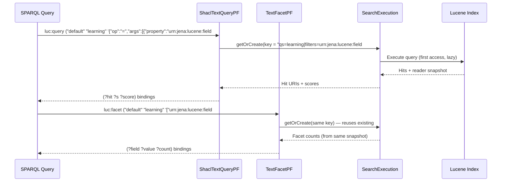
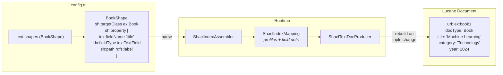

# Architecture

## Document Models

### Classic: Triple-Per-Document

The original `jena-text` model. Each RDF triple matching the entity map creates a separate Lucene document:

```
Triple: ex:book1 rdfs:label "Machine Learning"
  → Lucene doc: {uri: "ex:book1", text: "Machine Learning", lang: "en"}

Triple: ex:book1 ex:category "Technology"
  → Lucene doc: {uri: "ex:book1", category: "Technology"}
```

This is the upstream Jena text index, used with `text:entityMap` configuration and `text:query` for SPARQL search. No faceting support.

### SHACL: Entity-Per-Document

Introduced in Phase 2. Each entity (identified by `rdf:type` matching a shape's `sh:targetClass`) gets **one** Lucene document with all its fields:

```
Entity: ex:book1 (type ex:Book)
  → Lucene doc: {
      uri: "ex:book1",
      docType: "Book",
      title: "Machine Learning",
      category: "Technology",
      author: "Smith",
      year: 2024
    }
```

Used with `text:shapes` configuration. SPARQL search via `luc:query` (with filter support), facet counts via `luc:facet`.

**Advantages:**
- Single-pass faceting (text and facet fields on same document)
- Enables `DrillSideways` (future optimisation)
- Supports typed fields (int, long, double) for range queries
- Per-field configuration (stored, indexed, facetable, sortable)
- No overcounting from duplicate documents

---

## Key Classes

### Core (upstream, unmodified)

| Class | Role |
|-------|------|
| `TextQueryPF` | Implements `text:query` — upstream Jena text search property function |
| `EntityDefinition` | Maps RDF predicates to Lucene field names. Used by both modes |
| `TextIndexConfig` | Configuration holder passed to `TextIndexLucene` constructor |

### Core (extended)

| Class | Role |
|-------|------|
| `TextIndexLucene` | Central index implementation. Manages Lucene `IndexWriter`. Upstream methods unchanged; additive SHACL methods for faceting and entity document building |
| `Entity` | Represents a single indexable entity. `addValue()` supports multi-valued fields (additive) |

### SHACL Mode (all new files)

| Class | Role |
|-------|------|
| `ShaclIndexMapping` | Parsed data model: `IndexProfile` (shape), `FieldDef` (field), `FieldType` enum. Pure data, no RDF/Lucene dependencies beyond `Node` and `Analyzer` |
| `ShaclTextDocProducer` | Change listener. On triple add/delete, reads entity state from `MultiUnion(defaultGraph, unionGraph)`, builds Entity, calls `updateEntityForProfile()`. Supports data in default and named graphs |
| `ShaclTextQueryPF` | Implements `luc:query` — search with JSON filter support, `?totalHits` binding. Uses `SearchExecution` for shared state with `luc:facet` |
| `TextFacetPF` | Implements `luc:facet` — facet counts property function. Returns (field, value, count) bindings |
| `ShaclConfigPF` | Implements `luc:config` — matches a triple pattern over the index's configuration subgraph, copied at assembly when `text:exposeConfig true` |
| `SearchExecution` | Shared execution state. Stored in `ExecutionContext` keyed by normalised query params. Lazy-computes hits, facet counts, and total hit count. Holds the searcher the hits came from and reads entity IRIs, match details and child records on request |
| `HitReader` | Visits a set of hits in Lucene doc-ID order, one segment at a time; used by every per-hit read |
| `FieldValueReader` | Reads field values for `luc:match`, `luc:nestedMatch`, `luc:fields` and the `TextHit` query methods (`queryByFields`, `queryWithFilters`, `queryWithCql`), from doc values where they hold the value and from restricted stored-field decodes otherwise |
| `TextMatchPF`, `TextNestedMatchPF`, `TextFieldsPF` | Implement `luc:match`, `luc:nestedMatch` and `luc:fields`; each finds its search and hit through `?hit` |
| `FacetValue` | Immutable (value, count) pair for facet results |
| `ShaclIndexAssembler` | Parses `text:shapes` RDF config into `ShaclIndexMapping`. Reads `sh:targetClass`, `sh:path`, `sh:alternativePath`. No jena-shacl dependency |
| `ShaclTextIndexLucene` | Extended `TextIndexLucene` with taxonomy writer/reader for hierarchical facets, `MultiFacets`, and `extractHierarchyDrillDown()` |
| `IndexVocab` | `urn:jena:lucene:index#` namespace constants and PF URI strings |

### Assembler (minimally extended)

| Class | Role |
|-------|------|
| `TextIndexLuceneAssembler` | Builds `TextIndexLucene` from TTL config. Additive: detects `text:shapes` alongside existing `text:entityMap` path |
| `TextDatasetAssembler` | Builds text-indexed dataset. Additive: auto-creates `ShaclTextDocProducer` in SHACL mode |

---

## Shared Execution Flow

When `luc:query` and `luc:facet` appear in the same SPARQL query:



Both PFs build a normalised key from query parameters. `SearchExecution.getOrCreate()` stores/retrieves shared state in `ExecutionContext`.

Key normalisation: property URIs are sorted, filter map keys are sorted, filter values within each key are sorted. This ensures the same logical query always produces the same key regardless of argument ordering.

---

## Hit Path

### Held searcher

A Lucene doc ID is valid only against the reader it came from. `SearchExecution` keeps
the `IndexSearcher` its search ran on, holding one `SearcherManager` reference, while any
`luc:query` iterator over that search is open. `ShaclTextQueryPF` calls `retain()` before
searching and returns a `QueryIterPlainWrapper` subclass whose `closeIterator()` calls
`release()`; the last release returns the searcher. ARQ calls `closeIterator()` when the
iterator is exhausted, when the query is cancelled, and when a parent iterator or the
`QueryExecution` is closed, so an abandoned query releases it too. A `luc:query` call
that fails before returning its iterator releases in a `finally` block.

Reads that run after the last release, for example `luc:match` evaluated after a sort
drained `luc:query`, acquire the current searcher and compare its `IndexReader` with
the one the search used. `SearcherManager` returns the same reader until a commit
refreshes it, so with no commit in between the doc IDs are still valid and the read
proceeds. A different reader raises `QueryExecException`.

A larger window re-runs the search. It uses the held searcher when there is one, so the
pages of one query see one index state, and acquires the current one otherwise. The new
hits are new `SearchHit` objects, so nothing read for the old ones carries over.

### Lazy per-hit reads

`ShaclTextIndexLucene.searchHits` returns hits with rank, score and Lucene doc ID only.
The rest is read on request, each time for a batch of hits in doc-ID order through
`HitReader.inDocOrder`, which sorts the hits, starts each segment once, and writes the
results back onto the hits so rank order is kept:

| Data | Read when | Read how |
|---|---|---|
| Entity IRI | `luc:query`'s subject list has an `?entity` slot | The entity IRI doc value where the segment has one; otherwise `HitReader.OneStringField`, a `StoredFieldVisitor` that decodes the entity field and stops |
| Match details | First `luc:match` call | `Weight.matches` per hit, then `FieldValueReader` for the matched fields |
| Child records | First `luc:nestedMatch` call | One `ParentChildrenBlockJoinQuery` per hit for each nested clause of the filter, then `FieldValueReader` for each child |
| Field values | First `luc:fields` call for a field | `FieldValueReader` for the requested fields; cached per field by rank in `SearchExecution` |

Match details, child records and field values are computed for the requested hit plus
every hit `luc:query` has returned that lacks them, so a page is computed in one pass.
With `?hit` unbound they are computed for every cached hit.

### Value reader

`FieldValueReader` reads a set of fields for documents of one segment in increasing
doc-ID order. For each field and segment it checks the segment's `FieldInfo` once:

| Field | Segment has | Read from |
|---|---|---|
| `FieldDef.isValueInDocValues()` | `SORTED` or `SORTED_SET` doc values under the field's name | The doc value, with forward-only `advanceExact` |
| `FieldDef.isValueInDocValues()` | a stored copy only (written before the field was sortable) | Stored fields |
| any other | — | Stored fields |
| any | no `FieldInfo` | Nothing: no document in the segment has the field |

The stored fields of all fields read from them are decoded together, with one
`DocumentStoredFieldVisitor` restricted to those fields and their datatype and language
twins. Values from either source become terms through
`LiteralFieldSupport.reconstructNode`; a doc value passes no datatype or language, as
the stored path does for such a field. A field with `idx:stored false` returns nothing
even when it has a doc value.

`luc:match` passes the values to `selectStoredValue`, which picks the value the text
query matches. `luc:nestedMatch` reads child documents rather than the hits themselves.
A block never spans segments and children precede their parent, so with the hits in
doc-ID order the child doc IDs also only increase through a pass.

### Entity IRI doc value

`docFromMapping` writes the entity IRI as a `BinaryDocValuesField` on parent documents,
under its own field, `<entity field>__docValue`, beside the stored copy. It cannot be a
doc value of the entity field itself: child documents carry that field for block
deletes, and Lucene requires every document with a field to give it the same doc-value
type.

The type is chosen when the index opens: a new index takes the JVM system property
`jena.text.entityDocValues` (`binary`, the default; `sorted`; or `none`). The property
is a temporary switch for comparing the three reads in a benchmark, not configuration,
and is removed once the benchmark has decided. An index that already has the doc-value field
keeps its type, because Lucene rejects a document that gives an existing field another
doc-value type. An index written before the doc value existed takes new documents with
it. `readEntityNodes` checks each segment's `FieldInfo`, and each document, and falls
back to the one-field visitor where the doc value is absent.

### Hit lookup

Each `SearchExecution` created in a query gets a number from a per-query registry in the
`ExecutionContext`, and labels its hits `s<number>h<rank>`. `luc:match` and
`luc:nestedMatch` parse a bound `?hit` to find the search in the registry and the hit by
rank in its cached window: one lookup per incoming `?hit`, where each call used to scan
every cached hit. Two `luc:query` patterns over different searches in one query no longer
share labels, so each `?hit` resolves to its own search.

---

## SHACL Change Listener Flow

`ShaclTextDocProducer` handles all triple changes. The base dataset is always up-to-date when `change()` fires because `DatasetGraphTextMonitor` calls `super.add()` before `record()`.

The producer reads entity data from a `MultiUnion` graph combining the default graph and the union of all named graphs. This ensures entities are indexed regardless of whether data is loaded into the default graph or named graphs (e.g. N-Quads with `tdb2:unionDefaultGraph`).

### Indexing flow from config to Lucene document



### Change listener detail

```
DatasetGraphTextMonitor.add(g, s, p, o)
  ├── super.add(g, s, p, o)        ← base dataset updated FIRST
  └── record() → change(ADD, g, s, p, o)
        │
        ShaclTextDocProducer.change()
        ├── p == rdf:type?
        │     └── handleTypeChange()
        │           └── rebuildEntityDocuments(s)
        ├── mapping.isRelevantPredicate(p)?
        │     ├── top-level predicate?
        │     │     └── rebuild entity subject directly
        │     ├── nested child predicate?
        │     │     └── reverse nested join path from changed child node
        │     └── nested join predicate?
        │           └── locate join step, reverse join-path prefix to parent
        └── else: ignore (irrelevant predicate)

rebuildEntityDocuments(subject)
  ├── getAllGraph() → MultiUnion(defaultGraph, unionGraph)
  ├── Read rdf:type values from combined graph
  ├── Find matching IndexProfiles via classLookup
  ├── If no profiles match → deleteEntityByUri()
  └── For each matching profile:
        ├── Read all relevant triples from combined graph
        ├── Build Entity with addValue() for each field
        └── indexer.updateEntityForProfile(entity, profile)
              ├── docFromMapping() → builds typed Lucene Document
              ├── Delete existing doc by (uri + docType) composite query
              └── Add new document
```

---

## Hierarchical and Nested Facets Architecture

### Data Model

`HierarchyDef` (inner class of `ShaclIndexMapping`) represents a hierarchy dimension:
- `dimensionName` — auto-generated from level field names joined with `_` (e.g., `state_commodity`)
- `levels` — ordered list of `FieldDef` references (index 0 = parent, 1 = child, etc.)
- `getDepth()`, `getLevelIndex(field)`, `getLevel(i)` — navigation methods

`NestedDef` represents a repeated correlated child collection:
- `nestedName` — the child scope identifier: derived from `idx:joinPath`, or taken from the required `idx:nestedName` when the block has an `idx:externalSource` instead
- `joinPath` — the SHACL path used to enumerate child nodes
- `joinSteps` — the ordered forward/inverse predicate steps used for change monitoring
- `joinPredicates` — the predicate set used for change monitoring
- `fields` — child-scoped `FieldDef` references
- `hierarchies` — hierarchy dimensions declared inside that nested block

`FieldDef` now carries explicit scope metadata:
- root fields have `nestedName = null`
- child fields have `nestedName = <the owning block's scope name>`

This allows the runtime to distinguish:
- root fields evaluated from the entity node
- child fields evaluated from the nested join node

Hierarchies are declared either:
- per-shape via shape-level `idx:facetHierarchy`, or
- per-child-collection via `idx:nested / idx:facetHierarchy`

### Indexing

Hierarchical fields use Lucene's taxonomy API (`DirectoryTaxonomyWriter/Reader`). `ShaclTextIndexLucene` maintains a separate taxonomy directory alongside the main index.

During document building:

- root hierarchies use ordinary entity field values
- nested hierarchies iterate child records first, then emit one `FacetField` path per child record

Direct hierarchy example:
```
FacetField("state_commodity", "WA", "Gold")
```

Nested identifier example:
```
FacetField("identifierType_identifierValueExact", "Company", "Saltbush")
FacetField("identifierType_identifierValueExact", "HoleNumber", "BRO-DDH-001")
```

`FacetsConfig` is configured with `setHierarchical(true)` and `setMultiValued(true)` for each dimension.

Nested child records are now indexed via Lucene block join — each entity becomes a contiguous block of N child docs followed by 1 parent doc, written atomically via `IndexWriter.addDocuments(...)`. Child-scoped field values live ONLY on the child docs (no parent flattening). Hierarchy facet paths continue to be emitted on the parent doc, one path per child record.

Block-join discriminators:

- `_blockKind = "parent"` on parent docs, `_blockKind = "child"` on child docs
- `_nestedScope = <nestedName>` on child docs identifies which `idx:nested` block they belong to
- every doc in the block carries the same `docIdField` value so delete-by-parent-id hits the whole block

### Query-Time Behavior

Three CQL paths cooperate on nested fields:

1. **Per-clause block-join lift.** `CqlToLuceneCompiler.maybeLiftToParent` wraps any single child-scope clause's Lucene query in `ToParentBlockJoinQuery(inner, PARENTS_FILTER, ScoreMode.Avg)` so matching child docs surface their parent entity.
2. **Same-scope fold.** `compileSameScopeFold` detects AND/OR clauses targeting fields in the same `idx:nested` scope and combines them into ONE inner BooleanQuery wrapped in ONE `ToParentBlockJoinQuery` — same-child correctness. `buildInnerForLeaf` produces the raw child-doc query for each clause (bypassing the per-clause lift and the level-0 hierarchy short-circuit) so the fold combines before re-wrapping.
3. **Hierarchy drill-down folding.** `compileHierarchyDrillDowns` recognises contiguous `=` clauses on the levels of one configured hierarchy and folds them into a single `DrillDownQuery` over the per-child taxonomy paths. Runs after the same-scope fold, on whatever was not already consumed.

`extractHierarchyDrillDown()` in `ShaclTextIndexLucene` continues to derive drill-down paths for facet counting from `=` filters when the client is requesting hierarchy counts.

Text operators:

- `=` is exact-term equality — KEYWORD semantics, no analyzer.
- `text_query` is analyzer-aware: the supplied text is tokenised through the field's configured query analyzer and emitted as TermQuery (single token) or PhraseQuery (multi-token). Folds with sibling `=` clauses in the same nested scope.

Reads in flight:

- Every search/count site wraps its built query in `filterToParents(...)` so result iteration only ever sees parent docs.
- Plain field-scoped reads (`parseQueryForFields`, `buildNamedQuery`) partition target fields into root-scoped and per-nested-scope groups, then wrap each child-scope subquery in `ToParentBlockJoinQuery` before OR-combining at the parent level.

`collectFacetResults()` uses `FastTaxonomyFacetCounts` for hierarchy dimensions and `SortedSetDocValuesFacetCounts` for flat facets. `MultiFacets` combines both into a unified result map. Result keys use the child level field name (not the dimension name) so that `generateBindings()` returns proper field IRIs.

### Field IRI Resolution

`resolveFacetFieldNames()` auto-detects when a requested field IRI belongs to a hierarchy. It maps the field to the dimension name so the `MultiFacets` dispatch works correctly. Requesting `field#state` (level 0) returns top-level values; requesting `field#commodity` (level 1) with a parent filter returns child values.

### Change Monitoring

`ShaclTextDocProducer` treats predicates in three buckets:

- root-field predicates rebuild the entity directly
- nested child predicates rebuild parent entities by reversing the nested join path from the changed child node
- nested join predicates rebuild parent entities by locating the changed join step, then reversing the join-path prefix back to the parent

Reverse parent lookup currently supports `idx:joinPath` values made from:

- simple predicate steps
- inverse predicate steps
- sequences composed from those steps

Alternative join paths are still rejected for `idx:joinPath`.

### Key Classes

| Class | Hierarchy Role |
|-------|---------------|
| `ShaclIndexMapping.HierarchyDef` | Data model for hierarchy dimensions |
| `ShaclIndexMapping.NestedDef` | Data model for repeated child collections |
| `ShaclTextIndexLucene` | Taxonomy writer/reader lifecycle, block-join layout, parent/child doc emission, `wrapAsParent()`, `filterToParents()`, `extractHierarchyDrillDown()`, `MultiFacets` |
| `ShaclEntityBuilder` | Builds root fields plus nested child records from graph data (no parent flattening) |
| `CqlToLuceneCompiler` | Per-clause block-join lift via `maybeLiftToParent`, same-scope fold via `compileSameScopeFold`, hierarchy drill-down folding, `compileTextQuery` for analyzer-aware text matching |
| `ShaclIndexAssembler` | Parses `idx:facetHierarchy`, `idx:nested`, `idx:joinPath`, and scoped fields |
| `TextFacetPF` | Passes resolved facet fields and CQL through to index |

---

## Range Facets Architecture

### Design

Range facets are integrated into the existing `luc:facet` property function rather than a separate PF. The `facetFields` JSON array accepts both plain field IRI strings (for flat/hierarchical facets) and range specification objects (for numeric bucketed counts).

Public result shapes:

- flat and hierarchical facets may continue to use the legacy 3-slot form: `(?field ?value ?count)`
- any request containing a range object uses the 5-slot form: `(?field ?value ?low ?high ?count)`
- mixed flat + range requests also use the 5-slot form

### Lucene Integration

Range facets use a different Lucene API from flat facets:

| Facet type | Lucene API | Data source |
|-----------|-----------|-------------|
| Flat (KEYWORD) | `SortedSetDocValuesFacetCounts` | `SortedSetDocValuesFacetField` |
| Hierarchical | `FastTaxonomyFacetCounts` | `FacetField` (taxonomy) |
| Range (INT/LONG) | `LongRangeFacetCounts` | `SortedNumericDocValuesField` + `MultiLongValuesSource` |
| Range (DOUBLE) | `DoubleRangeFacetCounts` | `SortedNumericDocValuesField` + `MultiDoubleValuesSource.fromField(..., NumericUtils::sortableLongToDouble)` |

All three facet types share the same search collection step. After collection, flat facets query SSDV structures, hierarchical facets query the taxonomy index, and range facets query numeric docvalues with caller-specified bucket boundaries. For `DOUBLE`, the sorted numeric docvalues are stored in sortable-long form for sorting, then decoded back to doubles for range aggregation.

The important design point is that range boundaries are not part of the search itself. Shared execution is keyed by search parameters, while facet request details such as range boundaries are applied after shared collection.

### Boundary Semantics

Boundaries use the histogram bin-edge convention: contiguous, lower-inclusive, upper-exclusive `[low, high)`. This matches Lucene's `LongRange`/`DoubleRange` constructors, Solr, Elasticsearch, and numpy/pandas.

Open-ended ranges are represented by `null` sentinels in the boundary array, which map to `Long.MIN_VALUE`/`Long.MAX_VALUE` (or `Double` equivalents) in the Lucene range objects.

The public SPARQL output for a range bucket is explicit bounds, not a display label. Range rows bind `?low` and `?high` as typed numeric literals; open-ended buckets leave the missing bound unbound.

### Validation

- A numeric field (INT/LONG/DOUBLE) appearing as a bare string in the facet fields array produces an error; numeric facets require explicit range boundaries
- The wildcard `"*"` expands to flat and hierarchical fields only — range facets require explicit boundaries
- Range objects targeting non-numeric fields (KEYWORD/TEXT/LATLON) produce an error
- Mixed flat + range requests require the 5-slot `luc:facet` subject form

### Key Classes

| Class | Range Facet Role |
|-------|-----------------|
| `TextFacetPF` | Parses mixed facet fields array — detects objects vs strings, extracts `RangeFacetSpec` |
| `ShaclTextIndexLucene` | Writes numeric docvalues, performs numeric sort selection, and computes range buckets after shared search collection |
| `SearchExecution` | Shares search state by search parameters only; caches facet results per facet request |

---

## Lucene Field Mapping (SHACL Mode)

| FieldType | Lucene indexed field | Lucene stored field | Lucene DocValues |
|-----------|---------------------|--------------------|--------------------|
| TEXT | `TextField` | (via `TYPE_STORED`) | — |
| KEYWORD | `StringField` | (via `Store.YES`), except sortable fields with no normalizer and no literal metadata, whose sort doc value holds the value | `SortedSetDocValuesFacetField` (facetable), `SortedDocValuesField` or `SortedSetDocValuesField` (sortable) |
| INT | `IntPoint` | `StoredField(int)` | `SortedNumericDocValuesField` (facetable and/or sortable) |
| LONG | `LongPoint` | `StoredField(long)` | `SortedNumericDocValuesField` (facetable and/or sortable) |
| DOUBLE | `DoublePoint` | `StoredField(double)` | `SortedNumericDocValuesField` (facetable and/or sortable) |

Each entity document also gets:
- **URI field** (`ftIRI` type) — tokenized=false, stored=true, plus a `BinaryDocValuesField` of the IRI on parent documents, under `<field>__docValue` (see [Entity IRI doc value](#entity-iri-doc-value))
- **Discriminator field** — `StringField` with the target class local name (e.g., "Book")

---

## Performance Characteristics

### SortedSetDocValues Faceting

The SHACL mode uses Lucene's `SortedSetDocValuesFacetCounts` for facet counting:

- **O(1) counting** — uses pre-built DocValues structures, not document iteration
- **~25% more indexing time** compared to non-faceted fields (DocValues must be built at write time)
- **Memory overhead** — ~10-20 bytes per unique value per facetable field in the DocValues segment
- **High cardinality caution** — fields with very many unique values (e.g., URIs) can consume significant memory during facet collection. Use `text:maxFacetHits` to limit the search scope if needed.

### Best Practices

1. **Only enable faceting on fields you'll facet on** — set `idx:facetable true` selectively on KEYWORD and numeric fields
2. **Use `maxValues`** — don't request more facet values than the UI needs
3. **Use `minCount`** — exclude rare values to reduce result size
4. **Index rebuild required** — changing `idx:facetable`, `idx:sortable`, or `idx:multiValued` on a faceted/sortable field requires a full reindex since DocValues are built at write time
5. **`text:maxFacetHits`** — for large indexes, set this assembler property to cap the number of documents searched during facet collection. `0` (default) means unlimited.

### Entity Rebuild Cost

In SHACL mode, any relevant triple change triggers a full entity document rebuild. This reads all triples for the entity from the base dataset and replaces the Lucene document. For typical entities (< 50 triples), this is fast. For entities with hundreds of triples, this may be noticeable during high-frequency updates.

---

## Backward Compatibility

All changes are purely additive. The upstream Jena `jena-text` code paths are unmodified:

- `TextQueryPF` — upstream `text:query` implementation, unchanged
- `TextIndexLucene` core methods (`doc()`, `addDocument()`, `updateDocument()`) — unchanged
- `TextIndexLuceneAssembler` — `text:entityMap` path unchanged; `text:shapes` is an additive alternative
- `TextDatasetAssembler` — SHACL producer wiring only activates when `isShaclMode()` is true

New code lives in separate classes (`ShaclTextQueryPF`, `TextFacetPF`, `ShaclTextDocProducer`, etc.) and registers under the `luc:` namespace (`urn:jena:lucene:index#`), not the `text:` namespace.
