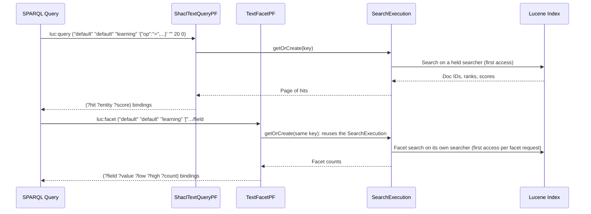

# Architecture

This page describes how the SHACL index in `jena-text` writes, searches and updates its
Lucene documents. Classes are in `org.apache.jena.query.text` unless a package is given.

## Document Models

| Model | Index type | Config | SPARQL | One Lucene document per | Facets |
|---|---|---|---|---|---|
| Classic (upstream) | `text:TextIndexLucene` | `text:entityMap` | `text:query` | triple | none |
| SHACL | `text:TextIndexShacl` | `text:shapes` | `luc:` property functions | entity | yes |

### SHACL: Entity-Per-Document

In classic mode, each triple that matches the entity map gives one Lucene document. In
SHACL mode, an entity is a subject whose `rdf:type` matches the `sh:targetClass` of a
shape. Each entity gives one Lucene document that holds all its fields:

```
ex:book1 (type ex:Book) → {uri: "ex:book1", docType: "Book", title: "Machine Learning",
                           category: "Technology", author: "Smith", year: 2024}
```

Consequences of one document per entity:

- Text fields and facet fields are on the same document, so one search gives both hits and
  facet counts.
- `luc:facet` can use Lucene's `DrillSideways` for
  [sideways counts](02-sparql-api.md#count-modes).
- `INT`, `LONG`, `DOUBLE` and `TEMPORAL` fields support range queries and range facets.
- Each field has its own settings: stored, indexed, facetable, sortable.
- A facet count counts entities, because each entity is one document.

---

## Key Classes

### Upstream classes changed by the fork

| Class | Change |
|-------|--------|
| `TextIndexLucene` | Builds a per-field query analyzer from `idx:queryAnalyzer`. `parseQuery` returns `MatchAllDocsQuery` for the query string `*`; this also applies to `text:query`. `MAX_N` and `parseQuery` are `protected` for the subclass |
| `EntityDefinition` | Holds the per-field query analyzer |
| `Entity` | `addValue()` collects several values for one field. Holds nested child records (`Entity.NestedRecord`) |
| `TextIndexConfig` | Holds the SHACL mapping, facet fields, `maxFacetHits`, `splitOnWhitespace` and `autoGeneratePhraseQueries`; `isShaclMode()` |
| `DatasetGraphText` | Commits and rolls back every index in a `TextIndexRegistry`. Index 0 keeps the upstream TDB2 component ID |
| `TextDatasetFactory` | Puts a `TextIndexRegistry` in the dataset context |
| `assembler.TextDatasetAssembler` | For a `ShaclTextIndexLucene`, creates a `ShaclTextDocProducer` and checks the index stamp (`checkOrCompletePairing`). Supports `text:indexes` and `text:buildOnStartup` |
| `TextQuery`, `assembler.TextAssembler`, `assembler.TextVocab`, `cmd.InitTextCmds`, `cmd.textindexdump` | Register the `luc:` property functions, the SHACL assembler, the new vocabulary and commands |

`TextQueryPF` (`text:query`) and `assembler.TextIndexLuceneAssembler` are unchanged.
`EntityDefinition` maps predicates to Lucene field names in both modes.

### SHACL mode classes

| Class | Role |
|-------|------|
| `ShaclTextIndexLucene` | The SHACL index. Extends `TextIndexLucene`. Builds entity documents (`docFromMapping`), writes block-join blocks, holds the taxonomy writer and reader for hierarchical facets, counts facets with `MultiFacets`, and derives drill-down paths with `extractHierarchyDrillDown()` |
| `ShaclIndexMapping` | Parsed data model: `IndexProfile` (shape), `FieldDef` (field), `FieldType` enum, `HierarchyDef`, `NestedDef`. Its only RDF and Lucene dependencies are `Node`, `Analyzer` and the `ShaclShapeCondition`s held by steps and occurrences |
| `assembler.ShaclTextIndexAssembler` | Builds a `ShaclTextIndexLucene` from a `text:TextIndexShacl` resource. Requires `text:shapes` |
| `assembler.ShaclIndexAssembler` | Parses `text:shapes` into a `ShaclIndexMapping`. Reads `sh:targetClass`, `sh:property`, `sh:path` (with jena-shacl's `ShaclPaths.parsePath`) and `sh:node` steps, with jena-shacl's `SHACL` vocabulary |
| `ShaclShapeCondition` | A jena-shacl node shape applied to one node: a step's filter, or a field occurrence's value constraints. Answers "does this node conform" with `VLib.validateShape` and produces no validation report. Lists the paths it reads, for change tracking |
| `ShaclEntityBuilder` | Builds root fields and nested child records from graph data |
| `ShaclTextDocProducer` | Change listener. Rebuilds the documents of the entities that a triple change affects. See [SHACL Change Listener Flow](#shacl-change-listener-flow) |
| `ShaclBulkIndexer` | Builds every entity document from a dataset. Used by `shacltextindexer` and `text:buildOnStartup` |
| `ShaclTextQueryPF` | `luc:query`: search with a CQL2-JSON filter, sort, paging and `?totalHits` |
| `TextFacetPF` | `luc:facet`: facet counts as `(?field ?value ?low ?high ?count)` rows |
| `TextMatchPF`, `TextNestedMatchPF`, `TextFieldsPF` | `luc:match`, `luc:nestedMatch` and `luc:fields`. Each finds its search and hit through `?hit` |
| `ShaclConfigPF` | `luc:config`: matches a triple pattern over the index configuration. The configuration is copied at assembly when `text:exposeConfig true` |
| `ShaclStatsPF` | `luc:stats`: matches a triple pattern over figures that `ShaclIndexStats` reads from the current searcher, cached per reader generation |
| `ShaclGraphPF` | Shared base of `ShaclConfigPF` and `ShaclStatsPF` |
| `SearchExecution` | Shared search state, stored in the `ExecutionContext` under a normalised key. Computes hits, facet counts and the total hit count on first use. Holds the searcher the hits came from and reads entity IRIs, match details and child records on request |
| `HitReader` | Visits a set of hits in Lucene doc-ID order, one segment at a time. Every per-hit read uses it |
| `FieldValueReader` | Reads field values for `luc:match`, `luc:nestedMatch`, `luc:fields` and the `TextHit` query methods (`queryByFields`, `queryWithFilters`, `queryWithCql`), from doc values where they hold the value and from restricted stored-field decodes otherwise |
| `cql.CqlToLuceneCompiler` | Compiles a CQL2-JSON filter to a Lucene query |
| `FacetRequest` | Parsed `facetFields`: flat fields, `RangeFacetSpec`s and the sideways flag |
| `FacetValue` | Immutable (value, count) pair |
| `assembler.IndexVocab` | Constants for the `urn:jena:lucene:index#` namespace, including the property function URIs |

---

## Shared Execution Flow

`luc:query` and `luc:facet` in one SPARQL query share one `SearchExecution` when their
search parameters match:



`SearchExecution.getOrCreate()` builds the key from these parts:

| Part | Normalisation |
|---|---|
| Index identity | — |
| Search fields | Sorted |
| Query string | — |
| CQL filter | `toCanonical()`: the arguments of `and` and `or` are sorted, and the values of `in` are sorted |
| Sort specs | `SortSpec.toCanonical()`, in the given order |
| Cursor (`after`) | Appended when present |

The same logical query gives the same key in any argument order. `luc:facet` passes no
sort spec and no cursor. A `luc:query` with a sort spec or a cursor therefore gets its own
`SearchExecution`.

The shared state is the parameters and the cached results. Facet counts and `?totalHits`
each acquire the current searcher, run, and release it. They see the same index state as
the hits unless a commit refreshed the index between the two.

Facet counts are cached per facet request (fields, `maxValues`, `minCount`, sideways
flag). An exception while computing facet counts is logged, and the request returns no
rows.

---

## Hit Path

### Held searcher

A Lucene doc ID is valid only against the reader it came from. `SearchExecution` keeps
the `IndexSearcher` its search ran on, holding one `SearcherManager` reference, while any
`luc:query` iterator over that search is open:

1. `ShaclTextQueryPF` calls `retain()` before it searches.
2. It returns a `QueryIterPlainWrapper` subclass whose `closeIterator()` calls `release()`.
3. The last `release()` returns the searcher.

ARQ calls `closeIterator()` when the iterator is exhausted, when the query is cancelled,
and when a parent iterator or the `QueryExecution` is closed. An abandoned query therefore
releases the searcher. A `luc:query` call that fails before it returns its iterator
releases in a `finally` block.

A read after the last release, for example `luc:match` evaluated after a sort drained
`luc:query`, acquires the current searcher and compares its `IndexReader` with the one
the search used. `SearcherManager` returns the same reader until a commit refreshes it.
If the reader is the same, the doc IDs are valid and the read proceeds. If it differs,
the read raises `QueryExecException`.

A larger window runs the search again. It uses the held searcher when there is one, so
all pages of one query see one index state. Otherwise it acquires the current searcher
and applies the same reader check, because the hit labels already returned name ranks in
the earlier search. The new hits are new `SearchHit` objects, and nothing read for the
old hits carries over.

### Lazy per-hit reads

`ShaclTextIndexLucene.searchHits` returns hits with rank, score and Lucene doc ID only.
Other data is read on request, for a batch of hits at a time, through
`HitReader.inDocOrder`. It sorts the hits by doc ID, starts each segment once, and writes
the results back onto the hits, so rank order is kept.

| Data | Read when | Read how |
|---|---|---|
| Entity IRI | The `luc:query` subject list has an `?entity` slot | The entity IRI doc value where the segment has one; otherwise `HitReader.OneStringField`, a `StoredFieldVisitor` that decodes the entity field and stops |
| Match details | First `luc:match` call | `Weight.matches` per hit, then `FieldValueReader` for the matched fields |
| Child records | First `luc:nestedMatch` call | One `ParentChildrenBlockJoinQuery` per hit for each nested clause of the filter, then `FieldValueReader` for each child |
| Field values | First `luc:fields` call for a field | `FieldValueReader` for the requested fields, cached per field by rank in `SearchExecution` |

Match details, child records and field values are computed for the requested hit and for
every hit that `luc:query` has returned and that lacks them. One pass therefore computes
a page. With `?hit` unbound, they are computed for every cached hit.

### Value reader

`FieldValueReader` reads a set of fields for the documents of one segment in increasing
doc-ID order. It checks the segment's `FieldInfo` once for each field and segment:

| Field | Segment has | Read from |
|---|---|---|
| `FieldDef.isValueInDocValues()` | `SORTED` or `SORTED_SET` doc values under the field name | The doc value, with forward-only `advanceExact` |
| `FieldDef.isValueInDocValues()` | A stored copy only (written before the field was sortable) | Stored fields |
| Any other | — | Stored fields |
| Any | No `FieldInfo` | Nothing: no document in the segment has the field |

All stored fields to read are decoded together, with one `DocumentStoredFieldVisitor`
restricted to those fields and their datatype and language twins.
`LiteralFieldSupport.reconstructNode` turns values from either source into RDF terms. A
doc value passes no datatype or language; the stored path also passes none for such a
field. A field with `idx:stored false` returns nothing, even when it has a doc value.

`luc:match` passes the values to `selectStoredValue`, which picks the value that the text
query matches. `luc:nestedMatch` reads child documents. A block is always in one segment
and its children come before its parent. With the hits in doc-ID order, the child doc IDs
therefore only increase through a pass.

### Entity IRI doc value

`docFromMapping` writes the entity IRI as a `BinaryDocValuesField` on parent documents,
in a field of its own, `<entity field>__docValue`, beside the stored copy. Child
documents carry the entity field for block deletes, and Lucene requires every document
with a field to give it the same doc-value type. The doc value therefore needs a separate
field.

An index written before the doc value existed adds it to new documents, so old and new
segments mix. `readEntityNodes` checks the `FieldInfo` of each segment, and each
document, and uses the one-field visitor where the doc value is absent.

### Hit lookup

Each `SearchExecution` in a query gets a number from a per-query registry in the
`ExecutionContext`, and labels its hits `s<number>h<rank>`. `luc:match` and
`luc:nestedMatch` parse a bound `?hit`, find the search in the registry, and find the hit
by rank in its cached window. This is one lookup per incoming `?hit`. Two `luc:query`
patterns over different searches in one query have different labels, so each `?hit`
resolves to its own search.

---

## SHACL Change Listener Flow

`ShaclTextDocProducer` handles all triple changes. `DatasetGraphTextMonitor` updates the
base dataset before it calls `record()`, so the base dataset is current when `change()`
runs.

The producer reads entity data from a `GraphUnionRead` over the default graph and every
named graph. Entities are therefore indexed whether their data is in the default graph or
in named graphs, for example N-Quads with `tdb2:unionDefaultGraph`.

The path from configuration to document is: `text:shapes` → `ShaclIndexAssembler` →
`ShaclIndexMapping` (profiles and field definitions) → `ShaclTextDocProducer` → one
Lucene document per entity, rebuilt on each relevant triple change.

### Change listener detail

```
DatasetGraphTextMonitor.add(g, s, p, o)
  ├── super.add(g, s, p, o)        ← base dataset updated first
  └── record() → change(ADD, g, s, p, o)
        │
        ShaclTextDocProducer.change()      (ADD and DELETE only)
        ├── p == rdf:type?
        │     └── handleTypeChange()
        │           ├── s, if a profile targets the type
        │           ├── entities whose occurrences require the class (sh:class)
        │           └── entities whose step filters or value constraints reach s
        ├── mapping.isRelevantPredicate(p)?
        │     ├── field occurrence predicate
        │     │     └── reverse the occurrence path, then the nested join path, to the entity
        │     ├── read by a step filter or a value constraint
        │     │     └── reverse the condition's path (step paths, then the path
        │     │         the condition reads) to the scope root
        │     └── nested join predicate
        │           └── locate the join step, reverse the join-path prefix to the parent
        ├── else: ignore
        └── outside a transaction: commit the index

rebuildEntityDocuments(subject)
  ├── Read rdf:type values from the union of all graphs
  ├── Find matching IndexProfiles by class
  ├── No profile matches → deleteEntityByUri()
  ├── Blank-node subject → log a warning, skip
  └── For each matching profile:
        ├── Profile has idx:externalSource → log a warning, skip (see below)
        ├── ShaclEntityBuilder builds the Entity from the union of all graphs
        └── indexer.updateEntityForProfile(entity, profile)
              ├── docFromMapping() and child documents → one block
              ├── Delete the block by (docIdField + discriminator) term query
              └── addDocuments(block): children first, parent last
```

A profile with an `idx:externalSource` is rebuild-only. A rebuild from the graph alone
would write the document without its external children, and Lucene has no partial
update. The producer therefore ignores live changes to such entities and logs that the
document is stale until `ShaclBulkIndexer` runs again.

---

## Hierarchical and Nested Facets

### Data model

`ShaclIndexMapping.HierarchyDef` is one hierarchy dimension:

- `dimensionName`: the IRI of the hierarchy when `idx:facetHierarchy` names one;
  otherwise the level field names joined with `_` (for example `state_commodity`).
  Naming a hierarchy changes its taxonomy key and needs a reindex.
- `levels`: the level `FieldDef`s in order, index 0 first. A hierarchy has at least two
  levels.
- `getDepth()`, `getLevelIndex(field)`, `getLevel(i)`.

`ShaclIndexMapping.NestedDef` is a repeated, correlated child collection:

- `nestedName`: the child scope name. It is derived from `idx:joinPath`, or taken from the
  required `idx:nestedName` when the block has an `idx:externalSource`.
- `joinPath`: the SHACL path that enumerates child nodes.
- `joinSteps`: the ordered forward and inverse predicate steps, for change monitoring.
- `joinPredicates`: the set of join predicates, for change monitoring.
- `fields`: the child-scope `FieldDef`s.
- `hierarchies`: the hierarchy dimensions declared in the block.

`FieldDef.nestedName` is `null` for a root field, which is read from the entity node. For
a child field it is the scope name of its block, and the field is read from the child
node.

A hierarchy is declared on a shape with `idx:facetHierarchy`, or in a child collection
with `idx:nested` / `idx:facetHierarchy`.

### Indexing

Hierarchical fields use Lucene's taxonomy API (`DirectoryTaxonomyWriter` and
`DirectoryTaxonomyReader`). `ShaclTextIndexLucene` keeps the taxonomy in a directory
beside the main index.

- A root hierarchy uses the entity's field values.
- A nested hierarchy writes one `FacetField` path per child record.

```
FacetField("state_commodity", "WA", "Gold")
FacetField("identifierType_identifierValueExact", "Company", "Saltbush")
FacetField("identifierType_identifierValueExact", "HoleNumber", "BRO-DDH-001")
```

`FacetsConfig` sets each dimension hierarchical and multi-valued.

Nested child records use Lucene block join. Each entity is a contiguous block of N child
documents followed by one parent document, written in one `IndexWriter.addDocuments(...)`
call. Child-scope field values are on the child documents only. Hierarchy facet paths are
on the parent document, one path per child record.

| Field | On | Value |
|---|---|---|
| `_blockKind` | Every document | `"parent"` or `"child"` |
| `_nestedScope` | Child documents | The `nestedName` of the `idx:nested` block |
| `docIdField` | Every document | The entity IRI, so a delete by entity removes the whole block |

### Query-time behaviour

`cql.CqlToLuceneCompiler` handles nested fields in three steps:

1. **Per-clause lift.** `maybeLiftToParent` wraps the Lucene query of a single
   child-scope clause in `ToParentBlockJoinQuery(inner, PARENTS_FILTER, ScoreMode.Avg)`,
   so matching child documents return their parent entity.
2. **Same-scope fold.** `compileSameScopeFold` finds `and` and `or` clauses on fields of
   one `idx:nested` scope and combines them into one inner `BooleanQuery` in one
   `ToParentBlockJoinQuery`, so all the clauses must match the same child.
   `buildInnerForLeaf` gives the raw child-document query for each clause, without the
   per-clause lift and the level-0 hierarchy shortcut, so the fold combines the clauses
   before it wraps them.
3. **Hierarchy drill-down fold.** `compileHierarchyDrillDowns` finds contiguous `=`
   clauses on the levels of one configured hierarchy and folds them into one
   `DrillDownQuery` over the per-child taxonomy paths. It runs after the same-scope fold,
   on the clauses that fold did not use.

`ShaclTextIndexLucene.extractHierarchyDrillDown()` derives drill-down paths for facet
counts from `=` clauses when the request asks for hierarchy counts.

Text operators:

| Operator | Behaviour |
|---|---|
| `=` | Exact term equality, as for `KEYWORD`. No analyzer |
| `text_query` | Analyzes the text with the field's query analyzer. One token gives a `TermQuery`, several give a `PhraseQuery`. Folds with sibling `=` clauses in the same nested scope |

Parent-only results:

- Every search and count wraps its query in `filterToParents(...)`, so result iteration
  sees parent documents only.
- Field-scoped reads (`parseQueryForFields`, `buildNamedQuery`) split the target fields
  into a root group and one group per nested scope. Each child-scope subquery is wrapped
  in `ToParentBlockJoinQuery`, and the groups are combined with OR at the parent level.

`collectFacetResults()` counts hierarchy dimensions with `FastTaxonomyFacetCounts` and
flat facets with `SortedSetDocValuesFacetCounts`. `MultiFacets` combines the two. Result
keys use the level field name, so `TextFacetPF.generateBindings()` returns field IRIs.

### Field IRI resolution

`resolveFacetFieldNames()` detects when a requested field IRI is a level of a hierarchy
and maps it to the dimension, so `MultiFacets` sends it to the taxonomy counts. A request
for `field#state` (level 0) returns top-level values. A request for `field#commodity`
(level 1) with a filter on the parent level returns child values.

### Join paths

The change listener follows nested join paths in reverse (see
[Change listener detail](#change-listener-detail)). `idx:joinPath` accepts predicate
steps, inverse predicate steps, and sequences of these. The assembler rejects alternative
paths in `idx:joinPath`. A field's `sh:path` also accepts alternatives.

---

## Range Facets

### Request and result

Range facets use `luc:facet`. The `facetFields` JSON array holds field IRI strings for
flat and hierarchical facets, and range objects for bucketed counts on numeric and
temporal fields. Every `luc:facet` call binds the 5-slot subject
`(?field ?value ?low ?high ?count)`. A range row binds `?low` and `?high` as typed
literals and leaves the missing bound of an open bucket unbound. A flat row binds `?value`
and leaves `?low` and `?high` unbound.

### Lucene integration

| Facet type | Lucene API | Data source |
|-----------|-----------|-------------|
| Flat (`KEYWORD`) | `SortedSetDocValuesFacetCounts` | `SortedSetDocValuesFacetField` |
| Hierarchical | `FastTaxonomyFacetCounts` | `FacetField` (taxonomy) |
| Range (`INT`, `LONG`) | `LongRangeFacetCounts` | `SortedNumericDocValuesField` + `MultiLongValuesSource` |
| Range (`DOUBLE`) | `DoubleRangeFacetCounts` | `SortedNumericDocValuesField` + `MultiDoubleValuesSource.fromField(..., NumericUtils::sortableLongToDouble)` |
| Range (`TEMPORAL`) | `LongRangeFacetCounts` | `SortedNumericDocValuesField` on `<field>__epoch` (epoch milliseconds) |

All facet types count from the same collected hits. Range facets apply the bucket
boundaries from the request. `DOUBLE` doc values are stored as sortable longs for sorting
and decoded to doubles for range counts.

`SearchExecution` is keyed by search parameters. Range boundaries apply after the shared
collection and are not part of the key.

### Boundaries

- Buckets are contiguous, lower-inclusive and upper-exclusive: `[low, high)`. Lucene's
  `LongRange` and `DoubleRange`, Solr, Elasticsearch and numpy/pandas use the same
  convention.
- A range object needs at least two boundaries.
- `null` is allowed only as the first or last boundary. It gives an open bucket and maps
  to `Long.MIN_VALUE` / `Long.MAX_VALUE` or the `Double` equivalents.
- `TEMPORAL` boundaries are ISO date strings, converted to epoch milliseconds.

### Validation

| Request | Result |
|---|---|
| A numeric or temporal field as a bare string in `facetFields` | Error: the field needs a range object |
| Wildcard `"*"` | Expands to flat and hierarchical fields only |
| A range object on a `TEXT`, `KEYWORD` or `LATLON` field | Error |
| A range object on a field that is not facetable | Error |
| A subject list with other than five slots | Error |

---

## Lucene Field Mapping

| FieldType | Indexed field | Stored field | Doc values |
|-----------|---------------------|--------------------|--------------------|
| `TEXT` | `TextField` | `TextField.TYPE_STORED` when stored | — |
| `KEYWORD` | `StringField` (the normalized term when `idx:normalizer` is set) | `Store.YES` or a `StoredField` of the raw value. A sortable field with no normalizer and no literal metadata keeps its value in the sort doc value only | `SortedSetDocValuesFacetField` (facetable); `SortedDocValuesField`, or `SortedSetDocValuesField` when multi-valued (sortable) |
| `INT` | `IntPoint` | `StoredField(int)` | `SortedNumericDocValuesField` (facetable or sortable) |
| `LONG` | `LongPoint` | `StoredField(long)` | `SortedNumericDocValuesField` (facetable or sortable) |
| `DOUBLE` | `DoublePoint` | `StoredField(double)` | `SortedNumericDocValuesField` of the sortable long (facetable or sortable) |
| `TEMPORAL` | `LongPoint` on `<field>__epoch` | `StoredField` of the lexical form | `SortedNumericDocValuesField` on `<field>__epoch` (facetable or sortable) |
| `LATLON` | `LatLonShape` fields from WKT or GeoJSON | Lexical form when stored | — |

A `TEMPORAL` value that does not parse logs a warning and gets no epoch field, so range
queries do not match it.

Each entity document also has:

- The **entity IRI field**: not tokenized, stored, plus a `BinaryDocValuesField` of the
  IRI on parent documents in `<field>__docValue` (see
  [Entity IRI doc value](#entity-iri-doc-value)).
- The **discriminator field** (`idx:discriminatorField`, default `docType`): a
  `StringField` with the local name of the profile's first `sh:targetClass`, for example
  `Book`.

---

## Performance Characteristics

### Facet counting

`SortedSetDocValuesFacetCounts` counts flat facets. It reads the doc-value ordinals of
each matching document, so the cost grows with the number of matching documents and the
number of values per document. Facetable fields add doc values at write time, which adds
indexing time and index size. A field with many unique values, for example IRIs, uses
more memory during facet collection.

### Recommendations

1. Set `idx:facetable true` only on `KEYWORD`, numeric and temporal fields that a client
   counts.
2. Set `maxValues` to the number of values the client shows.
3. Set `minCount` to drop rare values from the result.
4. Reindex after changing `idx:facetable`, `idx:sortable` or `idx:multiValued` on a field.
   Doc values are written at index time. At startup the server logs a warning when the
   index on disk was built from a different configuration (`ShaclConfigFingerprint`).

The assembler reads `text:maxFacetHits` (default `0`, unlimited) into the index, but no
facet search applies it. Facet counts cover every matching document.

### Entity rebuild cost

A relevant triple change rebuilds the whole entity document. The rebuild reads every
triple of the entity from the base dataset and replaces the document block. The cost
grows with the number of triples per entity and the number of child records.

---

## Backward Compatibility

The classic mode keeps its upstream code paths, with the changes listed in
[Upstream classes changed by the fork](#upstream-classes-changed-by-the-fork):

- `TextQueryPF` and `TextIndexLuceneAssembler` are unchanged.
- `TextIndexLucene.parseQuery` treats the query string `*` as match-all. This changes
  `text:query` for that string.
- A field without `idx:queryAnalyzer` uses its index analyzer for queries, as upstream.
  When `text:queryAnalyzer` is set, it applies to all fields, and `TextIndexLucene` logs a
  warning that per-field query analyzers are ignored. This warning also appears in
  classic mode.
- `TextDatasetAssembler` creates the SHACL change listener only for a
  `ShaclTextIndexLucene`.

The SHACL code is in separate classes (`ShaclTextIndexLucene`, `ShaclTextQueryPF`,
`TextFacetPF`, `ShaclTextDocProducer` and others). Its property functions are in the
`urn:jena:lucene:index#` namespace, prefix `luc:`.
